# State machines

Phase 1 output of `docs/plans/implicit-state-machines-2026-11-11.md` (2026-11-11).
Every lifecycle in the app that has states and transitions, explicit or not, with
the repro test that pins its current behaviour. Phase 3 replaces this hand-written
file with one generated from the transition registry.

How to read the verdicts:

- **CONFIRMED**: an illegal transition is reachable. The repro test asserts the
  correct behaviour and is marked `xfail(strict=True)` (Python) or `it.fails`
  (vitest). The fixer flips it to a plain test in the same change. A strict
  xfail that starts passing fails CI, so a fix cannot land unnoticed.
- **FALSE**: a guard already prevents it. A plain test pins the guard.
- **PARTIAL**: real but narrower than first reported, or by design. The note says
  which part is real.
- **NOT TESTED**: found by reading only. No test yet.

Repro test files:

| Area | File |
|---|---|
| Run path | `tests/test_state_machines_repro_run.py` |
| Money (unit) | `tests/test_state_machines_repro_money.py` |
| Money (live Postgres, skips without `REASONER_TEST_PG_DSN`) | `tests/integration/test_state_machines_repro_money_pg.py` |
| UI | `ui-next/src/**/*.statemachine.test.ts(x)` |

Measured 2026-11-11: Python 8 passed, 21 xfailed, 0 XPASS (with the live
Postgres test DB; without it the 6 PG tests skip). vitest 3 passed, 8
expected-fail. `tsc --noEmit` clean. Ruff ratchet unchanged at 2146.

Priority: **P0** money or data is wrong, **P1** a run or a user sees the wrong
state, **P2** a leak or a misleading message, **P3** documentation only.

## Phase 3 status (2026-11-12)

Every CONFIRMED row below is fixed and its repro test is now a plain test,
except where this table says otherwise. The per-machine sections further down
still describe the code as Phase 1 found it.

| Row | Fix | Where |
|---|---|---|
| B1 | Terminal states absorb. An illegal event is dropped whole, logged and counted, never raised on replay | `core/aggregates/pipeline.py` (`PIPELINE_RUN`, observe) |
| B2 | New `PIPELINE_CANCELLED` event. User stop and client disconnect both persist it; `reason` tells them apart. Old `cancelled:` / `client_disconnected:` failures replay as cancelled. `error` then `done` kept on purpose: the SDK and MCP read `done.errors` | `core/events/domain_events.py`, `api/execution/sse_observer.py`, `api/execution/pipeline.py`, `application/handlers/handlers.py` |
| B4 | A run that spent money keeps its claim. `release_unstarted` then `metered()` releases once | `application/services/run_metering.py` |
| B6 | Claim value is a holder token. Release and complete are compare-and-set Lua scripts. A finished claim is marked `done` (`KEEPTTL`), so a retry gets 409 "already finished" | `infrastructure/redis/run_state.py`, `redis/in_memory.py`, `application/services/idempotency.py` |
| B7 | `add()` clears a stale cancel flag. `pop_cancelled` deleted (no caller) | `infrastructure/redis/run_state.py` |
| M1 | `cancelled` is terminal per provider subscription id, enforced in the SQL `WHERE`. Stripe `incomplete`, `unpaid`, `paused` get their own non-live statuses; an unknown status logs and maps to `past_due`. A Stripe upsert no longer adopts a cancelled row. `past_due` keeps the paid tier (comment fixed) | `domain/saas.py`, `infrastructure/persistence/subscription_repo.py` (`subscription`, enforce), `infrastructure/billing/stripe_adapter.py` |
| M2 | Complete and release act only for the lease holder (`claimed_at` match). Dead-letter replay marks replayed only when the row is `done` | `infrastructure/billing/webhooks.py` |
| M3 | A release write requires its `<ref>:reserve` entry, checked under the balance lock. The 30-day trim logs what it dropped | `application/services/credit_service.py`, both credit repos, `infrastructure/valkey/unsettled_runs.py` |
| M7 | `account_deletion_log.status` (`requested`, `erasing`, `erased`, `partial`) with a unique `user_id`. A partial erase is retried by calling DELETE again; that one route is exempt from the 403 | `application/services/data_eraser.py` (`account_deletion`, enforce), `api/saas_router.py`, `api/dependencies.py` |
| M8 | Upload settle and delete-adjust run in a shielded cancel scope | `api/routes/uploads.py` |
| U1 | Every late cleanup checks `run.superseded(ticket)`. A reducer union was not used: `running` has 9 writers across the store. Dead `activeRun` slice deleted | `ui-next/src/hooks/useRunController.ts`, `app/chat/page.tsx` |
| U3 | A stream that ends with no terminal frame throws "Stream ended early". Abort listener removed | `ui-next/src/hooks/usePipelineStream.ts` |
| U5 | A failed load sets `subscriptionError` and keeps the last good data | `ui-next/src/stores/app-store.ts` |
| U6 | `loadMore` reads the store at write time | `ui-next/src/hooks/useConversationHistory.ts` |

Migrations: `20261111_000500_status_checks` (`CHECK ... NOT VALID` on
`subscriptions.status` and `processed_webhooks.status`) and
`20261111_000600_account_deletion_status` (status column, dedupe that keeps the
earliest row per user, unique index, `CHECK ... NOT VALID`). `VALIDATE` waits
for a `SELECT DISTINCT status` audit on production.

Still open after Phase 3:

- **U5:** no UI reads `subscriptionError` yet. A failed first load with no cached plan still shows "Free".
- **B1:** the event store's `aggregates.status` column is still upserted without a guard, so that table can still show `failed` after `completed`. The aggregate replay is correct.
- **U3:** the resume stream (`handleResume`) does not go through `usePipelineStream`.
- **Redis:** the B6 Lua scripts were tested with fakes only. `KEEPTTL` needs Redis 6 or later.

## Phase 4 status (2026-11-12)

Every row below is a registered machine in observe mode: an illegal move is
logged and counted, never refused. The concrete bug each row named is fixed
except where noted.

| Row | Machine | Fix | Where |
|---|---|---|---|
| B5 | `run_admission` | Held resources are released newest-first by one helper; a release that raises or is cancelled no longer skips the rest | `api/run_admission.py` |
| B8 | `ws_replay` | A complete run is absorbing: later events are dropped and counted, not buffered or fanned out | `infrastructure/websocket/manager.py` |
| B9 | `neuro_session_tier` | Hot to warm writes temp files, `os.replace`, then unlinks the source, so a session is never in two tiers. `stats` and the listings share one glob | `neuro/sessions.py` |
| M4 | `quota_slot` | A slot release is a no-op once the quota period has reset after the claim. `RunContext.created_at` carries the claim time. The duplicate UPDATE branches in `sync_quota_for_subscription` are merged | `application/services/quota_service.py`, `run_metering.py`, quota repos |
| M5 | `anon_trial` | The refund is one Lua script: no key is created, the value floors at 0, `KEEPTTL` | `application/services/anonymous_trial_policy.py` |
| M6 | `api_key` | `touch_last_used` skips a revoked key | `domain/api_keys.py` (table), `api_key_service.py`, both api key repos |
| M9 | `ws_ticket` | The WebSocket handshake refuses a ticket whose account is deleted, and fails closed on a lookup error | `application/services/ws_ticket.py`, `api/routes/websocket.py`, `api/dependencies.py` |
| U2 | `ws.connection` | `connected` clears `lastError`. A failure during reconnect retries until the budget is spent. One connect in flight; the old socket is closed and detached | `ui-next/src/hooks/useWebSocketPipeline.ts` |
| U4 | `auth` | `logout` lands in `anonymous`, `markSessionExpired` in `expired`. `isAuthenticated` is derived from `user`. `useRequireAuth` redirects on `expired` too | `ui-next/src/stores/app-store.ts`, `hooks/useRequireAuth.ts` |
| U7 | `useAsyncAction` | Checkout uses the shared hook: one pending action, reset on a bfcache restore. The double checkout was already guarded on the pricing page | `ui-next/src/hooks/useAsyncAction.ts`, `app/pricing/page.tsx`, `components/layout/UpgradeModal.tsx` |
| U8 | `useAsyncAction` | Login, signup and reset share the hook; email and OAuth cannot both be pending | `ui-next/src/app/{login,signup,reset-password}/page.tsx` |
| U9 | (status union) | `useQuota` starts `loading`. NeuroPanel has one error per feature. `useCredits` and the API keys list expose a `status` | `ui-next/src/hooks/{useQuota,useCredits}.ts`, `components/layout/NeuroPanel.tsx`, `app/settings/api-keys/page.tsx` |

Not done in Phase 4:

- **M10:** `users.email_verified` has no writer. Deleting it or designing a verification flow is the user's call (plan §5, question 3).
- **U4:** a 401 in the middle of a run does not stop the run. The auth store has no handle on the run controller.
- **B8:** a `error` frame is not treated as terminal. A pipeline id reused after completion has its events dropped until the buffer is evicted.
- **M5:** the refund Lua script was tested against a fake Valkey only.
- **Tests:** the signup and reset-password pages, NeuroPanel and the API keys page have no test of their own.

## Registered machines (generated)

Diagrams of every `core.state_machine.Machine`, rewritten by
`python scripts/update_mindmap_meta.py`. Do not edit between the markers. The
hand-drawn diagrams in the sections below show the code as it is today,
illegal edges included; each is replaced by its generated twin once Phase 3
converts the machine.

<!-- gen:state-machines:start -->
### `account_deletion` (enforce)

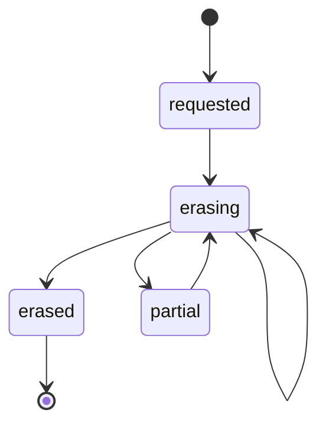

### `anon_trial` (observe)

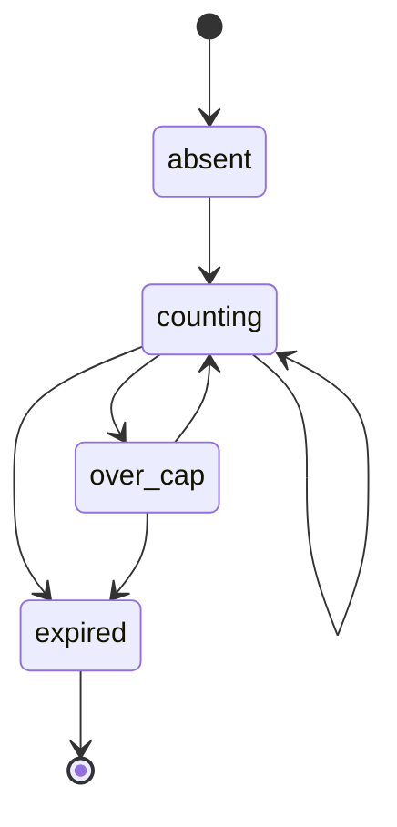

### `api_key` (observe)

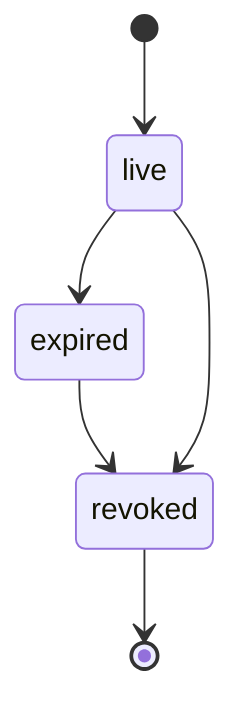

### `neuro_session_tier` (observe)

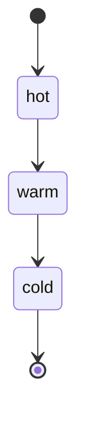

### `pipeline_run` (observe)

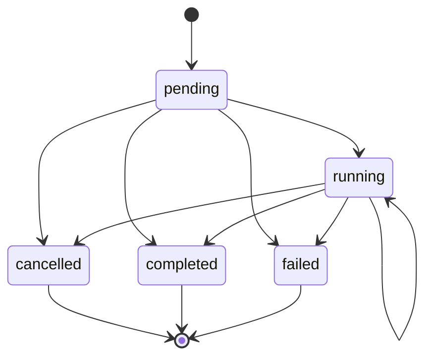

### `quota_slot` (observe)

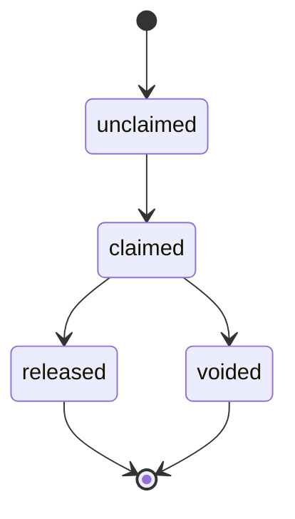

### `run_admission` (observe)

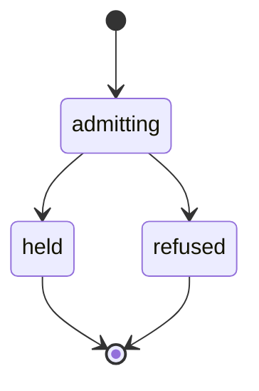

### `subscription` (enforce)

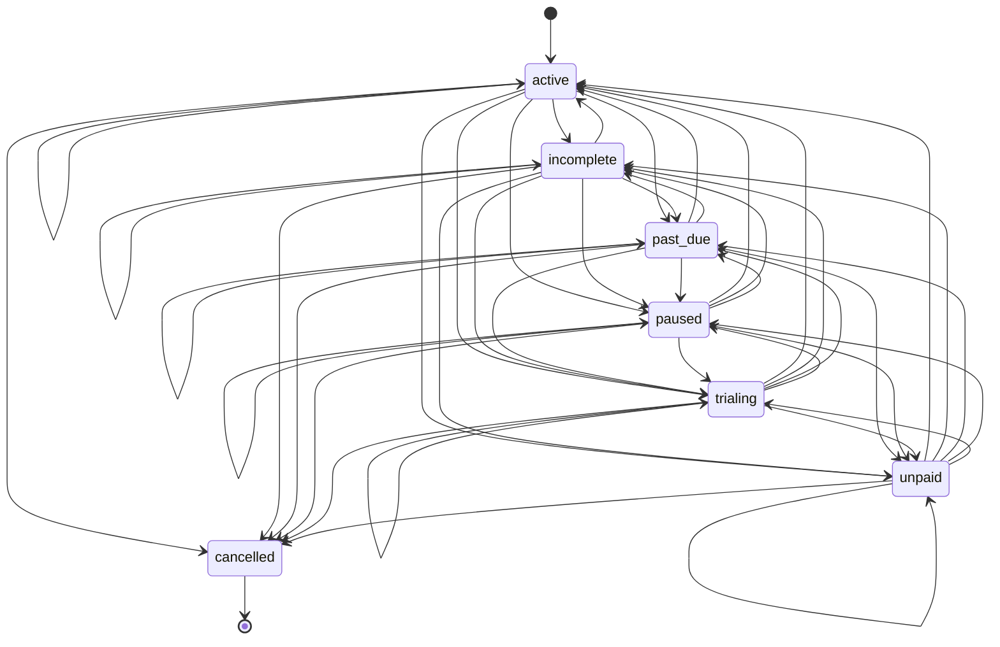

### `ws_replay` (observe)

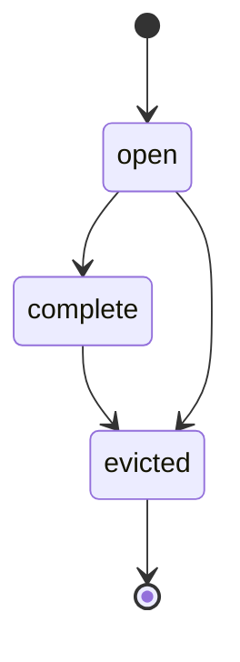

### `ws_ticket` (observe)

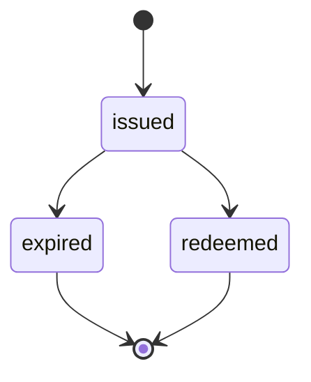
<!-- gen:state-machines:end -->

The UI machines (`ui-next/src/lib/state-machine.ts`) are not in this registry:
their tables live in TypeScript and are tested by vitest.

---

## 1. Run path

### B1. Pipeline aggregate status

Owner: `core/aggregates/pipeline.py`. Writers: the `apply` handlers for
started (`:179-185`) and completed/failed (`:231-244`).

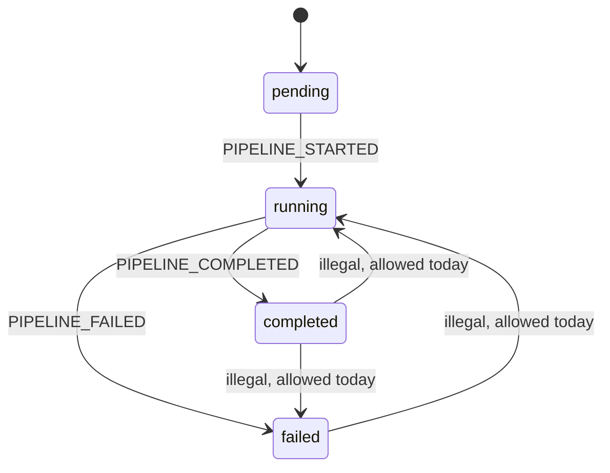

| Check | Verdict | Test |
|---|---|---|
| A `failed` event after `completed` overwrites the status | CONFIRMED, P1 | `test_b1_failed_after_completed_keeps_completed` |
| A `started` event after a terminal event resets it to running | CONFIRMED, P1 | `test_b1_started_after_terminal_does_not_reset` |
| `can_resume()` is true for a run with no terminal event | FALSE, by design | `test_b1_running_without_terminal_is_resumable_by_design`, `test_b1_terminal_run_is_not_resumable` |

Resuming a run that was killed hard is what `can_resume()` is for.

### B2. Run outcome vocabularies

Owners: `application/ports/run_outcome.py` (`RunStatus`),
`api/execution/sse_observer.py`, `api/execution/pipeline.py`. Five vocabularies
describe the end of a run: `RunStatus`, SSE frame types, `EventType`, the
history `status` string (`api/history.py:28`), and the `client_disconnected:`
error prefix.

| Check | Verdict | Test |
|---|---|---|
| A client disconnect is stored as `PIPELINE_FAILED` with a string prefix (`sse_observer.py:184-196`) | CONFIRMED, P1 | `test_b2_disconnect_is_not_stored_as_failure` |
| A user cancel persists no terminal event, so the run stays `running` and resumable (`api/execution/pipeline.py:320-325, 541`) | CONFIRMED by reading, P1 (worse than the plan said) | none yet; needs an `execute_run`-level test |
| `RunStream.failed()` emits `error` then `done` (`sse_observer.py:219-228`) | CONFIRMED, debatable | `test_b2_failed_emits_single_terminal_frame` |

`EventType` has no cancelled member, so the fix needs a new event type. Check
the SDK contract tests before removing `done` after `error`: the SDK may treat
`done` as the end of the stream.

### B4. Run metering claim

Owner: `application/services/run_metering.py` (`metered()`, `:217-293`;
`release_unstarted`, `:316-329`).

| Check | Verdict | Test |
|---|---|---|
| `completed=False` with cost > 0 releases the idempotency claim (`:285`) | CONFIRMED, P0 | `test_b4_spent_run_without_done_keeps_claim`; guard `test_b4_free_run_without_done_releases_claim` |
| Claim released twice | PARTIAL | `test_b4_claim_released_at_most_once` |

The double release happens only if `metered()` is entered after
`release_unstarted` ran, which the normal flow avoids. It does harm through the
B6 owner-check gap.

### B6. Idempotency claim

Owners: `application/services/idempotency.py:82-101`,
`infrastructure/redis/run_state.py:204-218`.

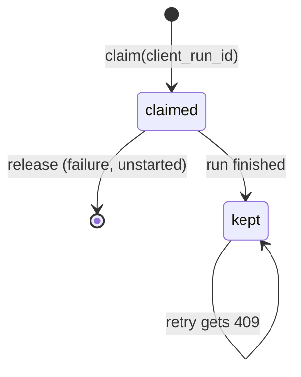

| Check | Verdict | Test |
|---|---|---|
| A finished run's retry is refused | PARTIAL, intended | `test_b6_finished_run_retry_is_refused_by_design` |
| Release is not owner-checked, so a stale holder frees a new holder's claim | CONFIRMED, P0 | `test_b6_stale_release_does_not_free_new_holders_claim` |

A finished run keeps its claim on purpose. The gap is that there is no `done`
state, so the 409 says "in progress".

### B7. Cancel flag

Owner: `infrastructure/redis/run_state.py` (`request_cancel` `:259-271`,
`add` `:220-231`, `remove` `:243`, `is_cancelled` `:346-357`).

| Check | Verdict | Test |
|---|---|---|
| A cancel that lands after `remove()` lingers and cancels a reused run id | CONFIRMED, P1, Redis store only | `test_b7_late_cancel_does_not_cancel_reused_run_id` |
| `remove()` clears a flag set before it | FALSE | `test_b7_remove_clears_a_flag_set_before_it` |
| `pop_cancelled` has no production caller | CONFIRMED, harmless | `test_b7_cancel_requested_polls_is_cancelled_not_pop` |

Fix in `add()` (clear on registration) or in `request_cancel` (refuse inactive
ids), not in `remove()`.

### Also run path, not tested in Phase 1

| Machine | Owner | Note |
|---|---|---|
| B3. PipelineState flags | `domain/pipeline_state.py:132, 153` | `pivot_active` written at `application/pipeline.py:603` and `flows/language_probe_phase.py:62`; `ranking_degraded` at `flows/perspective_phases.py:331, 359` |
| B5. Admission | `api/execution/pipeline.py` | see plan §1.1 |
| B8. WS replay | `infrastructure/websocket/` | see plan §1.1 |
| B9. Neuro tiers | `neuro/` | see plan §1.1 |
| Circuit breaker | `infrastructure/circuit_breaker.py:39` | already an explicit `CircuitState` enum; the reference shape for Phase 2 |
| Harness promotion | `domain/harness_metrics.py:225` | `status: str`; `"pending" \| "promoted" \| "rolled_back"` lives only in a comment |
| Telemetry circuit state | `domain/telemetry.py:41` | `circuit_state: str` duplicates `CircuitState` as a string |

---

## 2. Money

### M1. Subscription

Owners: `infrastructure/persistence/subscription_repo.py`,
`infrastructure/billing/stripe_adapter.py`, `domain/saas.py`
(`SubscriptionStatus`, `LIVE_STATUSES` `:86-87`). The `subscriptions.status`
column is `TEXT NOT NULL` with no `CHECK`.

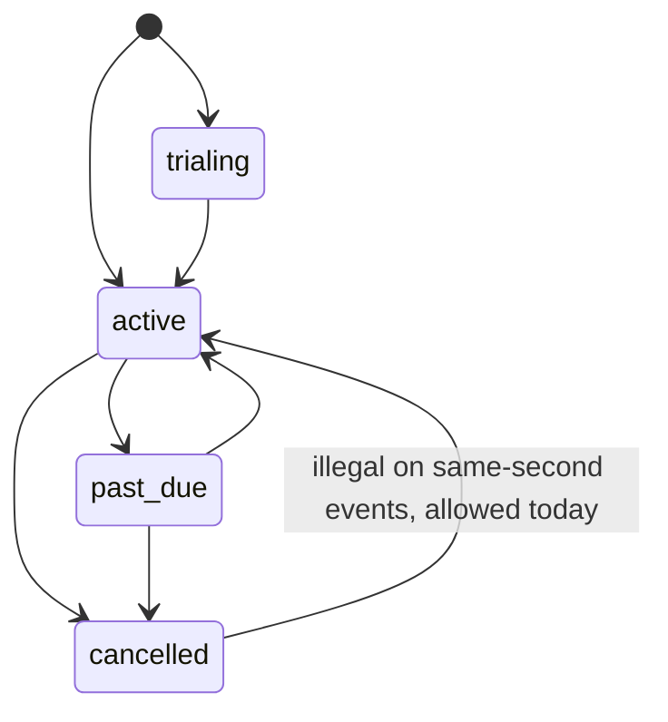

| Check | Verdict | Test |
|---|---|---|
| A same-second update revives a cancelled row (`last_event_at <= $9`, `:186`) | CONFIRMED, P0 | pg `test_m1_same_second_update_does_not_revive_a_cancelled_subscription` |
| Stripe `incomplete`, `unpaid`, `paused` map to cancelled by default | CONFIRMED, P0 | `test_m1_unknown_stripe_status_is_not_silently_cancelled[...]` (3 cases) |
| `past_due` keeps the paid tier | FALSE as code; the comment at `quota_service.py:63-66` is stale, P3 | `test_m1_past_due_is_live_so_it_keeps_the_paid_tier` |
| A Stripe upsert adopts a PayPal cancel tombstone | CONFIRMED, P0 | pg `test_m1_stripe_upsert_does_not_adopt_a_paypal_tombstone` |

### M2. Webhook claim (`processed_webhooks`)

Owner: `api/webhooks.py`. States are `processing` and `done`
(migration `20261021_000200`), with no `CHECK`.

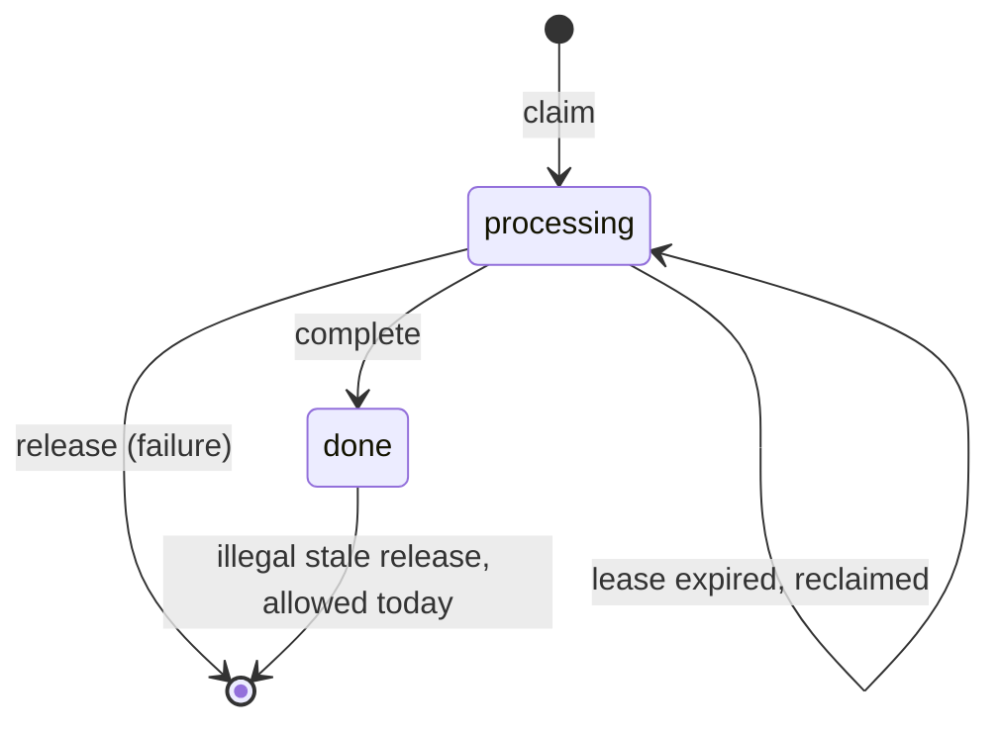

| Check | Verdict | Test |
|---|---|---|
| A stale worker's release deletes another worker's `done` row (`:182-199`) | CONFIRMED, P0 | pg `test_m2_stale_worker_release_cannot_delete_a_done_row` |
| A dead letter is marked replayed when another worker holds a live lease (`:424-428`) | CONFIRMED, P0 | pg `test_m2_dead_letter_not_marked_replayed_when_nothing_ran` |
| `_db_complete_webhook` is not owner-checked (`:165-180`) | CONFIRMED by reading | none |

Root cause of the dead-letter row: `_db_claim_webhook` returns `False` for both
`done` and a live `processing` row. Replay should mark replayed only on `done`.

### M3. Credits

Owners: `application/services/credit_service.py:182-215`,
`infrastructure/valkey/unsettled_runs.py:30-31`.

| Check | Verdict | Test |
|---|---|---|
| A release without a matching reserve credits the user | CONFIRMED, P0 | `test_m3_release_without_reserve_does_not_credit_the_user` |
| Unsettled entries older than 30 days are dropped with no log | CONFIRMED, P2 (retention is by design, for GDPR) | `test_m3_expired_unsettled_entry_is_not_dropped_silently` |

### M7. Account deletion

Owners: `api/saas_router.py`, `api/dependencies.py:121`, table
`account_deletion_log` (migration `20260929_000000`). The table has no `status`
column and no unique index on `user_id`.

| Check | Verdict | Test |
|---|---|---|
| A repeat delete writes a second log row (`saas_router.py:229`) | CONFIRMED, P1 | `test_m7_repeat_delete_writes_one_log_row`; pg `test_m7_deletion_log_is_unique_per_user` |
| A partial erase leaves no status and no retry path (the account gets 403) | CONFIRMED, P0 | pg `test_m7_deletion_log_records_erase_status` |
| Provider cancel runs before the log write | PARTIAL, deliberate | `test_m7_provider_cancel_runs_before_the_deletion_log` |

The order is right: a failed cancel must return 502 and leave the account
usable. The fix is a `status` column (`requested`, then `erasing`, then
`erased` or `partial`), not a reorder.

### M8. Upload usage

Owner: `api/routes/uploads.py`.

| Check | Verdict | Test |
|---|---|---|
| The settle in `finally` is not shielded, so a cancelled upload leaks its reservation (`:127-134`) | CONFIRMED, P1 | `test_m8_cancelled_upload_still_settles_its_reservation` |
| Delete then adjust is not atomic (`:183-187`) | NOT TESTED | none |

### Also money, not tested in Phase 1

M4 quota, M5 anonymous counter, M6 API key (`auth_legacy.py:50` `is_active`;
revoke at `routes/account_keys.py:115`), M9 WS ticket, M10 `email_verified`
with no writer: see plan §1.2. The `aggregates.status` column (baseline
migration, default `'pending'`) has no `CHECK` either.

---

## 3. UI

### U1. Chat run

Owners: `ui-next/src/app/chat/page.tsx`, `hooks/useRunController.ts`.
`running` has 9 writers in `page.tsx` (`:303, 351, 381, 545, 946, 977, 1013,
1038, 1110`).

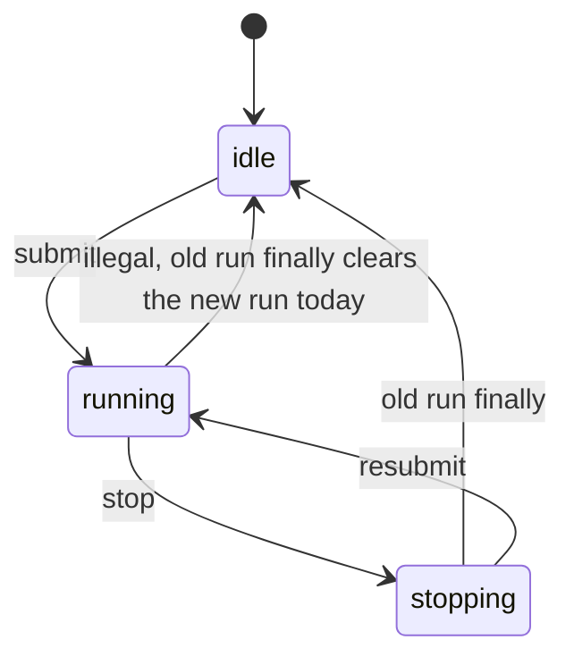

| Check | Verdict | Test (`hooks/useRunController.statemachine.test.tsx`) |
|---|---|---|
| After stop and an immediate resubmit, the old run's `finally` clears `running` of the new run (`page.tsx:975-977`) | CONFIRMED, P1 | `it.fails` "SM-U1: old run finally must not clear running of the new run" |
| The same `finally` disconnects the new run's WebSocket | CONFIRMED, P1 | `it.fails` "...must not disconnect the WS of the new run" |
| `useRunController` ticket guard | FALSE | "SM-U1 (holds)" |
| An SSE error leaves `running` set | FALSE as stated: the outer `finally` clears it once the stream ends | none |
| The `activeRun` store slice is dead | CONFIRMED by grep, P3 | none |

The U1 tests drive the real `useRunController` and the real store through a
harness that mirrors the page's `finally`, not the page itself.

### U3. Pipeline SSE stream

Owner: `hooks/usePipelineStream.ts`.

| Check | Verdict | Test (`hooks/usePipelineStream.statemachine.test.ts`) |
|---|---|---|
| A stream that closes with no `done` or `error` is treated as success | CONFIRMED, P1 | `it.fails` "SM-U3: a stream that closes without done/error must surface an error" |
| The abort listener on the run signal is never removed | CONFIRMED, P2 | `it.fails` "SM-U3: the run-signal abort listener is removed once the stream ends" |

### U5. Subscription cache

Owner: `stores/app-store.ts` (`subscription` has 5 writers, including
`app/providers.tsx:40`).

| Check | Verdict | Test (`stores/app-store.statemachine.test.ts`) |
|---|---|---|
| A non-OK response sets `subscription=null` with no error, so a paying user looks free | CONFIRMED, P1 | `it.fails` "SM-U5: a non-OK response must set subscriptionError, not look like free" |
| A failed refetch drops the last good value | CONFIRMED, P1 | `it.fails` "a failed (non-OK) refetch keeps last good" |
| A thrown (network) failure drops the last good value | CONFIRMED, P1 | `it.fails` "a thrown (network) failure keeps last good" |

### U6. Conversation history paging

Owner: `hooks/useConversationHistory.ts:41`.

| Check | Verdict | Test (`hooks/useConversationHistory.statemachine.test.ts`) |
|---|---|---|
| A row deleted while `loadMore` is in flight comes back (stale closure) | CONFIRMED, P1 | `it.fails` "SM-U6: a row deleted while loadMore is in flight must not reappear" |

### U7. Checkout

Owner: `app/pricing/page.tsx`.

| Check | Verdict | Test (`app/pricing/page.statemachine.test.tsx`) |
|---|---|---|
| Two rapid clicks start two checkouts | FALSE on the pricing page (`disabled={!!loadingTier}`) | "SM-U7: a second click while checkout is in flight starts no second checkout", "the other provider button is also locked" |

The guard is state, not a ref. It holds because a click is a discrete event that
React flushes at once. The `UpgradeModal`, settings and dashboard checkout calls
and the bfcache spinner were not tested.

### Also UI, not tested in Phase 1

| Machine | Owner | Note |
|---|---|---|
| U2. WS client | `hooks/useWebSocketPipeline.ts:9` | explicit `ConnectionStatus` union, 9 `setStatus` writers |
| U4. Auth | `stores/app-store.ts:21` | explicit `AuthStatus`; `user` and `isAuthenticated` have 3 writers each and can disagree |
| U8. Auth forms | `app/login`, `app/signup`, `app/reset-password` | explicit `idle \| submitting \| success`, separate `error` string |
| U8b. Forgot password | `app/forgot-password/page.tsx:32-33` | `loading` + `error`, not the shared form union |
| U9. Data hooks | `hooks/useCredits.ts`, `hooks/useQuota.ts`, `app/settings/api-keys/page.tsx` (4 flags), `components/layout/NeuroPanel.tsx` (3 loading flags + 1 error) | independent `loading`/`error` pairs |
| Status page poll | `app/status/StatusClient.tsx:16` | explicit `PollState` union |
| Phase card | `components/phases/PhaseCard.tsx:42` | `idle \| active \| completed \| error \| degraded` |

---

## 4. Corrections to the plan

These change Phase 2 steps. Apply them to the plan before Phase 2 starts.

1. **B2**: a user cancel persists no terminal event at all. Only a disconnect is
   stored as `PIPELINE_FAILED`. Add an `execute_run`-level repro first.
2. **B7**: `remove()` already clears the flag. The fix belongs in `add()` or
   `request_cancel`.
3. **B1**: the handlers are at `pipeline.py:179-185` and `:231-244`, not `:137`.
4. **M1 past_due**: the code keeps the paid tier on purpose. Fix the comment at
   `quota_service.py:63-66`. No behaviour change unless the open question in
   plan §5 decides otherwise.
5. **M7**: do not move the log write before the provider cancel. Add a `status`
   column instead.
6. **M3 30-day trim**: the retention is by design. The defect is the missing log.
7. **M2 dead letter**: mark replayed only when the row is `done`.
8. **U1**: the "SSE error leaves running" row is false as stated.
9. **U5**: a thrown error also wipes good data, not only a non-OK response.
10. **U7**: the pricing page is guarded. Check the other checkout call sites.

## 5. Not covered in Phase 1

Plan §1.4 areas that still have no sweep or test:
`hypergate/jev_router.py`, `hyperagent.py`, `application/flows/runner.py`,
per-method flows (`dialectical_phases.py` and `cognitive_phases.py` have the
most status/state hits in the sweep), email and OAuth, `spend_limit_service`,
`pipeline_ownership_repo` (`_backfill_done` module flag at `:174-229`),
`ui-next/src/lib/db.ts`, `providers.tsx`, the `page.tsx:384-735` `onEvent` body,
`sdk/typescript` (no status hits), the CLI `--resume`, and `headless.py`.
